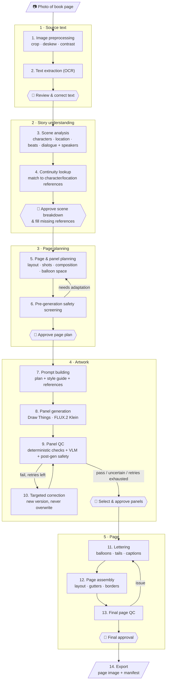

# Malazan AI Comic Studio: Single-Page Pipeline Plan

**Goal of this milestone:** take one photographed book page and turn it into one finished, lettered comic page. Make every step work reliably on that page before scaling up.

**Status:** planning. No code, folders or library yet. We'll go through the steps one at a time.

---

## Pipeline diagram

👤 = human checkpoint. For the first page every checkpoint is manual. Later we can automate the ones that prove reliable.

---

## Steps

Each step lists its **input**, its **output**, and **open questions** to settle when we get to it.

### 1 · Source text

#### Step 1: Image preprocessing
Prepare the photo so OCR works well.
- **Input:** photo of a book page (phone or camera).
- **Output:** cleaned image (cropped to the text block, straightened, normalized contrast). The original is kept untouched.
- **Open questions:** Single page or two-page spreads? How much page curvature and shadow do your photos usually have?

#### Step 2: Text extraction (OCR)
- **Input:** cleaned image.
- **Output:** plain text with paragraph breaks preserved, plus provenance (book, chapter, page number, photo file).
- **Options to compare:** Apple Vision framework (built into macOS, local, very good on printed text), Tesseract, or a local vision-language model through Ollama.
- **Open questions:** Which engine handles your photos best? We'll test 2–3 on the same page.

#### ✅ Checkpoint 1: Review & correct text
You correct OCR mistakes. Everything downstream depends on this text, so it has to be right.

### 2 · Story understanding

#### Step 3: Scene analysis
Pull out the structured story content.
- **Input:** corrected text.
- **Output:** a scene breakdown containing:
  - characters present (and those only mentioned)
  - location, time of day, weather, lighting
  - key objects and props
  - story **beats** in order (what happens, the emotion)
  - dialogue lines with **speaker identity** stored separately from the text
  - narration that might become captions
- **Open questions:** Which local text model can do this well enough? Is it acceptable for Claude to help here as a one-off authoring step?

#### Step 4: Continuity lookup
- **Input:** scene breakdown.
- **Output:** each character/location linked to a reference entry (description, appearance state at this point in the story, reference images), or flagged as **missing**.
- **For the first page:** a small hand-written reference sheet per character instead of a real library.
- **Open questions:** How do we create the first reference portraits? (Generate candidates → you approve one.)

#### ✅ Checkpoint 2: Approve scene breakdown & fill missing references

### 3 · Page planning

#### Step 5: Page & panel planning
- **Input:** approved scene breakdown + references.
- **Output:** a page plan with:
  - page layout (number of panels, grid/arrangement, reading order)
  - per panel: beat, characters, shot type (wide/medium/close-up), camera angle, composition, expressions, props
  - per panel: dialogue/captions and a **reserved area for balloons**, so the art leaves room for text
- **Open questions:** How many panels per page? How much of the excerpt fits on one page? Fixed layout templates first, or free layouts?

#### Step 6: Pre-generation safety screening
- **Input:** page plan.
- **Output:** pass / adapt / escalate for each panel, with reasons. "Adapt" sends the panel back to planning with a safer framing (implication, reaction, aftermath).
- **Open questions:** Write the first version of the content policy as a short rules file.

#### ✅ Checkpoint 3: Approve page plan

### 4 · Artwork

#### Step 7: Prompt building
Turn each panel into a generation request, **in code**, not by hand.
- **Input:** panel plan + style guide + character/location descriptions + reference images.
- **Output:** prompt, negative cues, size/aspect ratio, reference images, seed.
- **Open questions:** What prompt structure works best for FLUX.2 Klein? Does it use reference images for consistency, and does Draw Things expose that through its API?

#### Step 8: Panel generation
- **Input:** generation request.
- **Output:** one or more candidate images per panel, plus a record of every parameter (model, seed, steps, prompt, references) so it can be reproduced.
- **Open questions:** Which Draw Things API (HTTP vs gRPC) and which parameters it supports. This is the Phase 1 connectivity test.

#### Step 9: Panel QC
- **Input:** candidate image + its panel plan.
- **Output:** a QC report: pass / fail / uncertain per check, with details.
  - *Deterministic:* size/aspect ratio, balloon area not too busy, basic image sanity.
  - *VLM:* right characters present, matches references, expression/action match, no stray text, anatomy, style.
  - *Post-generation safety check.*
- **Open questions:** Which Qwen3-VL size fits in RAM next to Draw Things? (Probably run them one after the other.)

#### Step 10: Targeted correction
- **Input:** failed QC report.
- **Output:** a new image version linked to its parent (regenerate with a new seed, adjust the prompt, or edit a region). Never overwrites.
- **Retry limit:** configurable (e.g. 3). After that it goes to you.

#### ✅ Checkpoint 4: Select & approve panels

### 5 · Page

#### Step 11: Lettering
- **Input:** approved panels + dialogue/captions from the plan.
- **Output:** balloons and caption boxes drawn **in code** (Pillow/SVG), with tails pointing at the speaker. Text stays editable.
- **Open questions:** How do we know where the speaker is in the image? (Plan hint → VLM/face detection → manual click.) Which font? (A free comic lettering font.)

#### Step 12: Page assembly
- **Input:** lettered panels + layout.
- **Output:** full page at print-ready resolution, with gutters and borders.

#### Step 13: Final page QC
- **Output:** checks that the text matches the script exactly, reading order is clear, balloons don't cover faces or each other, tails point to the right speakers, and no panel is missing.

#### ✅ Checkpoint 5: Final approval

#### Step 14: Export
- **Output:** page PNG (and/or PDF) + a manifest that records the source page, plan, chosen panel versions, parameters and QC results.

---

## Build milestones

*Steps* are the order the pipeline runs in. *Milestones* (lettered, so they don't get confused with step numbers) are the order we build things in, starting with the riskiest parts:

- **Milestone A:** Draw Things connectivity → Step 8 *(current)*
- **Milestone B:** photo → text → Steps 1–2
- **Milestone C:** scene analysis → page plan, semi-manual at first → Steps 3, 5
- **Milestone D:** prompt building + first real panels → Step 7
- **Milestone E:** lettering & assembly → first complete page → Steps 11–12
- **Milestone F:** automated QC and correction → Steps 9–10
- **Milestone G:** stricter continuity, safety and final QC → Steps 4, 6, 13

## Environment (checked 2026-11-07)

- Apple M4, 24 GB unified memory, macOS 15.7.3
- Draw Things installed and running; HTTP API enabled on `127.0.0.1:7860` (localhost only)

## Milestone A findings (2026-11-07) ✅

- `GET /` returns the app's full current config as JSON (model, sampler, steps, etc.).
- `POST /sdapi/v1/txt2img` works; we send only the overrides, the app supplies the rest.
- Current setup: `flux_2_klein_9b_q8p.ckpt`, DDIM Trailing, 4 steps, guidance 1, shift 3, seed mode "Scale Alike".
- 768×1024 takes **~94 s** per image on the M4.
- **Same seed + same settings → pixel-identical image.** File hashes differ (PNG metadata), so later version tracking should hash pixel data, not file bytes.
- Script: `scripts/dt_txt2img.py` (stdlib only), outputs to `outputs/milestone_a/` with a JSON sidecar.
- Not yet tested: choosing the model per request, img2img / reference images (needed for Milestone D).
- System Python is 3.9.6 (old; we may want a newer Python)

## Milestone B findings (in progress)

- B1 ✅ `source/manifest.yaml`: Gardens of the Moon, Prologue, pages 3–8 (English paperback), photos `1-3.jpg` … `1-8.jpg`.
- B2 ✅ `scripts/ocr_vision.swift`: Apple Vision OCR, no installs. Picks the rotation where lines come out horizontal (correct for all 6 photos). Raw output in `outputs/ocr/<photo>.vision.json`.
- Clean flat pages read almost perfectly. Errors are mostly single letters (`Bum's`→Burn's, `holred`→bolted, `chem`→them).
- **Vision's confidence scores are not useful**: wrong words usually still get 1.0. Error detection must come from elsewhere (dictionary + names list, human review).
- Facing-page text gets picked up; it differs clearly in position and angle, so it can be filtered.
- Curved pages lose the ends of lines near the spine (`1-6.jpg`). This can't be recovered from the photo.
- Language correction on is slightly better than off.
- B3 ✅ `scripts/clean_ocr.py`: deterministic cleanup → `outputs/text/<photo>.clean.txt`, `<photo>.flags.json`, `prologue.clean.txt` (with `⟨pN⟩` page markers). Keeps the main text column (using start position, angle and centre of lines), orders lines by their left edge, detects paragraphs from indent + short previous line, joins hyphenation only if the joined word is in the dictionary, normalises quotes, flags unknown words (macOS dictionary + `source/names.txt`).
- Remaining issues are left for the correction pass (B3b): misread words, cut-off line ends, dropped opening quotes, the large first letter, a few wrong paragraph breaks.
- ❌ Full-page transcription with Claude (via `claude -p`; script since deleted) is **blocked by the API's content filter** ("Output blocked by content filtering policy"): Claude won't output long verbatim passages of a published novel. This is a policy limit, not a bug, and we don't work around it. Consequence: **verbatim text stays a local job** (Vision OCR + rules + human/local-model correction). Claude can still work *from* the text (analysis, panel planning) as long as its output isn't a reproduction of it. Watch for this in later steps that quote dialogue.
- B3c ✅ `scripts/check_text.py`: local error checks → `outputs/text/<photo>.checks.json`. Each flag has a type, the word, a suggestion, context and the photo line box (for review crops). Checks: unknown word, one-letter-confusion from a known name (`Canoes`→Ganoes, `Bum's`→Burn's), known OCR-misread real words (`dean`→clean, `it you`→if you), quote balance, missing drop cap, possible cut-off line (weak), and disagreement with a second Vision reading (language correction off, `<photo>.vision-raw.json`). ~66 flags over 6 pages, mostly real errors.
- B4 ✅ `scripts/review_server.py` + `scripts/review.html`: local review UI (stdlib only, `127.0.0.1:8765`). Works page by page: one card per paragraph (photo crop, editable text, flags answered with *Use suggestion* / *Fixed it myself* / *Text is correct*), *Finish page →* moves to the next page. Autosaves to `outputs/text/review.json` (+ `.bak`), exports `outputs/text/prologue.reviewed.md` and per page `outputs/text/reviewed/p<N>.md` + `status.json` (which pages are finished). Later steps can start as soon as one page is finished. `--reset` starts over from OCR output.
- Known misses: real-word errors outside the lists (`him land`, `You new`), so human review of the full text is still needed once.
- Decision (superseded for transcription, see above): Claude may be used for correction (user on personal tokens). Optional later: Claude returns only a *list* of suspected errors (not the text). Each correction is labelled *read* (visible in photo) or *inferred* (guessed from context); the user reviews only *inferred* ones.

## Milestone C decisions & findings (in progress)

- **1 book page = 1 comic page.** If a page's last paragraph continues on the next book page, it's left out and carried over (`outputs/comic/carryover/to_p<N+1>.md`), then joined with its ending on the next page. A short page (e.g. chapter end) becomes a closing splash page.
- **Text on the page:** dialogue word for word; narration condensed and only where the image can't show it.
- **Claude (`claude -p`) does analysis and planning.** Its output is analysis/plan, not the book text.
- `source/story_facts.md`: facts the analysis may use beyond the current page (e.g. Ganoes is 12). No spoilers.
- C0 ✅ `scripts/prepare_page.py <N>` → `outputs/comic/page-<NNN>/input.json` (paragraph ids P1…, carry-over handling).
- C1 ✅ `scripts/analyze_scene.py <N>` → `scene.json` (characters, locations, objects, atmosphere, beats, captions, dialogue, open questions, all with paragraph evidence) + `scene.meta.json`. Never overwrites: older versions are renamed. Page 3: ~28 s.

- C1b ✅ `scripts/analyze_chapter.py` → `outputs/comic/chapter-<section>/brief.json`: Claude reads the **whole chapter first** (reviewed text where finished, otherwise cleaned OCR). Characters/locations/objects with facts + page revealed, timeline, plot **reveals** with "don't hint before page N", OCR doubts. Prologue: ~57 s. Page analysis uses all descriptive facts, but only reveals up to the current page.
- C1c ✅ **Questions step** in the review UI (tab *2 · Questions* per page): run the analysis, answer the open questions (scope: whole story / this page). Each question comes **pre-filled with Claude's recommendation + reason**; untouched = recommendation accepted. Stored in `source/decisions.json` (`source`: recommended / user); used by the analysis and later the planner. Empty answer = planner decides.
- C2 ✅ `scripts/plan_page.py <N> [--note "..."]` → `page_plan.json`: tiers (rows) with panel widths/heights, per panel beats, shot, angle, characters (position/pose/expression/facing), lighting, visual description, captions/dialogue with placement, space to keep free for text, safety notes; plus `design_choices` where answers left options open. Deterministic layout validation (sums, numbering). Never overwrites. Page 3: 5 panels / 3 tiers, ~50 s.
- UI: *2 · Questions* has **Accept answers & create page plan →**; *3 · Plan* shows a layout sketch + panel details, **Re-plan with feedback**, **Accept plan →**.
- Workflow per page: **Text review → Analysis → Questions → Page plan → (Milestone D) panel generation**.

## Still needed

- A sample photo of the book page to start with
