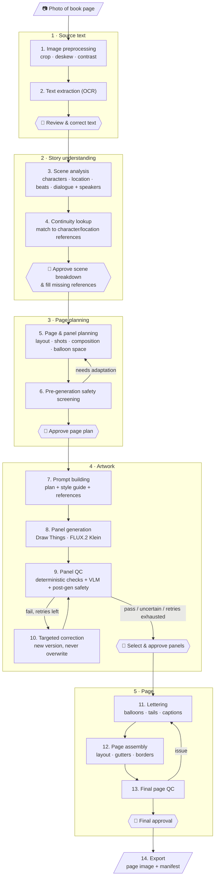

# Malazan AI Comic Studio: Single-Page Pipeline Plan

**Goal of this milestone:** take one photographed book page and turn it into one finished, lettered comic page. Make every step work reliably on that page before scaling up.

**Status:** planning. No code, folders or library yet. We'll go through the steps one at a time.

---

## Pipeline diagram

👤 = human checkpoint. For the first page every checkpoint is manual. Later we can automate the ones that prove reliable.

---

## Steps

Each step lists its **input**, its **output**, and **open questions** to settle when we get to it.

### 1 · Source text

#### Step 1: Image preprocessing
Prepare the photo so OCR works well.
- **Input:** photo of a book page (phone or camera).
- **Output:** cleaned image (cropped to the text block, straightened, normalized contrast). The original is kept untouched.
- **Open questions:** Single page or two-page spreads? How much page curvature and shadow do your photos usually have?

#### Step 2: Text extraction (OCR)
- **Input:** cleaned image.
- **Output:** plain text with paragraph breaks preserved, plus provenance (book, chapter, page number, photo file).
- **Options to compare:** Apple Vision framework (built into macOS, local, very good on printed text), Tesseract, or a local vision-language model through Ollama.
- **Open questions:** Which engine handles your photos best? We'll test 2–3 on the same page.

#### ✅ Checkpoint 1: Review & correct text
You correct OCR mistakes. Everything downstream depends on this text, so it has to be right.

### 2 · Story understanding

#### Step 3: Scene analysis
Pull out the structured story content.
- **Input:** corrected text.
- **Output:** a scene breakdown containing:
  - characters present (and those only mentioned)
  - location, time of day, weather, lighting
  - key objects and props
  - story **beats** in order (what happens, the emotion)
  - dialogue lines with **speaker identity** stored separately from the text
  - narration that might become captions
- **Open questions:** Which local text model can do this well enough? Is it acceptable for Claude to help here as a one-off authoring step?

#### Step 4: Continuity lookup
- **Input:** scene breakdown.
- **Output:** each character/location linked to a reference entry (description, appearance state at this point in the story, reference images), or flagged as **missing**.
- **For the first page:** a small hand-written reference sheet per character instead of a real library.
- **Open questions:** How do we create the first reference portraits? (Generate candidates → you approve one.)

#### ✅ Checkpoint 2: Approve scene breakdown & fill missing references

### 3 · Page planning

#### Step 5: Page & panel planning
- **Input:** approved scene breakdown + references.
- **Output:** a page plan with:
  - page layout (number of panels, grid/arrangement, reading order)
  - per panel: beat, characters, shot type (wide/medium/close-up), camera angle, composition, expressions, props
  - per panel: dialogue/captions and a **reserved area for balloons**, so the art leaves room for text
- **Open questions:** How many panels per page? How much of the excerpt fits on one page? Fixed layout templates first, or free layouts?

#### Step 6: Pre-generation safety screening
- **Input:** page plan.
- **Output:** pass / adapt / escalate for each panel, with reasons. "Adapt" sends the panel back to planning with a safer framing (implication, reaction, aftermath).
- **Open questions:** Write the first version of the content policy as a short rules file.

#### ✅ Checkpoint 3: Approve page plan

### 4 · Artwork

#### Step 7: Prompt building
Turn each panel into a generation request, **in code**, not by hand.
- **Input:** panel plan + style guide + character/location descriptions + reference images.
- **Output:** prompt, negative cues, size/aspect ratio, reference images, seed.
- **Open questions:** What prompt structure works best for FLUX.2 Klein? Does it use reference images for consistency, and does Draw Things expose that through its API?

#### Step 8: Panel generation
- **Input:** generation request.
- **Output:** one or more candidate images per panel, plus a record of every parameter (model, seed, steps, prompt, references) so it can be reproduced.
- **Open questions:** Which Draw Things API (HTTP vs gRPC) and which parameters it supports. This is the Phase 1 connectivity test.

#### Step 9: Panel QC
- **Input:** candidate image + its panel plan.
- **Output:** a QC report: pass / fail / uncertain per check, with details.
  - *Deterministic:* size/aspect ratio, balloon area not too busy, basic image sanity.
  - *VLM:* right characters present, matches references, expression/action match, no stray text, anatomy, style.
  - *Post-generation safety check.*
- **Open questions:** Which Qwen3-VL size fits in RAM next to Draw Things? (Probably run them one after the other.)

#### Step 10: Targeted correction
- **Input:** failed QC report.
- **Output:** a new image version linked to its parent (regenerate with a new seed, adjust the prompt, or edit a region). Never overwrites.
- **Retry limit:** configurable (e.g. 3). After that it goes to you.

#### ✅ Checkpoint 4: Select & approve panels

### 5 · Page

#### Step 11: Lettering
- **Input:** approved panels + dialogue/captions from the plan.
- **Output:** balloons and caption boxes drawn **in code** (Pillow/SVG), with tails pointing at the speaker. Text stays editable.
- **Open questions:** How do we know where the speaker is in the image? (Plan hint → VLM/face detection → manual click.) Which font? (A free comic lettering font.)

#### Step 12: Page assembly
- **Input:** lettered panels + layout.
- **Output:** full page at print-ready resolution, with gutters and borders.

#### Step 13: Final page QC
- **Output:** checks that the text matches the script exactly, reading order is clear, balloons don't cover faces or each other, tails point to the right speakers, and no panel is missing.

#### ✅ Checkpoint 5: Final approval

#### Step 14: Export
- **Output:** page PNG (and/or PDF) + a manifest that records the source page, plan, chosen panel versions, parameters and QC results.

---

## Build milestones

*Steps* are the order the pipeline runs in. *Milestones* (lettered, so they don't get confused with step numbers) are the order we build things in, starting with the riskiest parts:

- **Milestone A:** Draw Things connectivity → Step 8 *(current)*
- **Milestone B:** photo → text → Steps 1–2
- **Milestone C:** scene analysis → page plan, semi-manual at first → Steps 3, 5
- **Milestone D:** prompt building + first real panels → Step 7
- **Milestone E:** lettering & assembly → first complete page → Steps 11–12
- **Milestone F:** automated QC and correction → Steps 9–10
- **Milestone G:** stricter continuity, safety and final QC → Steps 4, 6, 13

## Environment (checked 2026-11-07)

- Apple M4, 24 GB unified memory, macOS 15.7.3
- Draw Things installed and running; HTTP API enabled on `127.0.0.1:7860` (localhost only)

## Milestone A findings (2026-11-07) ✅

- `GET /` returns the app's full current config as JSON (model, sampler, steps, etc.).
- `POST /sdapi/v1/txt2img` works; we send only the overrides, the app supplies the rest.
- Current setup: `flux_2_klein_9b_q8p.ckpt`, DDIM Trailing, 4 steps, guidance 1, shift 3, seed mode "Scale Alike".
- 768×1024 takes **~94 s** per image on the M4.
- **Same seed + same settings → pixel-identical image.** File hashes differ (PNG metadata), so later version tracking should hash pixel data, not file bytes.
- Script: `scripts/dt_txt2img.py` (stdlib only), outputs to `outputs/milestone_a/` with a JSON sidecar.
- Not yet tested: choosing the model per request, img2img / reference images (needed for Milestone D).
- System Python is 3.9.6 (old; we may want a newer Python)

## Milestone B findings (in progress)

- B1 ✅ `source/manifest.yaml`: Gardens of the Moon, Prologue, pages 3–8 (English paperback), photos `1-3.jpg` … `1-8.jpg`.
- B2 ✅ `scripts/ocr_vision.swift`: Apple Vision OCR, no installs. Picks the rotation where lines come out horizontal (correct for all 6 photos). Raw output in `outputs/ocr/<photo>.vision.json`.
- Clean flat pages read almost perfectly. Errors are mostly single letters (`Bum's`→Burn's, `holred`→bolted, `chem`→them).
- **Vision's confidence scores are not useful**: wrong words usually still get 1.0. Error detection must come from elsewhere (dictionary + names list, human review).
- Facing-page text gets picked up; it differs clearly in position and angle, so it can be filtered.
- Curved pages lose the ends of lines near the spine (`1-6.jpg`). This can't be recovered from the photo.
- Language correction on is slightly better than off.
- B3 ✅ `scripts/clean_ocr.py`: deterministic cleanup → `outputs/text/<photo>.clean.txt`, `<photo>.flags.json`, `prologue.clean.txt` (with `⟨pN⟩` page markers). Keeps the main text column (using start position, angle and centre of lines), orders lines by their left edge, detects paragraphs from indent + short previous line, joins hyphenation only if the joined word is in the dictionary, normalises quotes, flags unknown words (macOS dictionary + `source/names.txt`).
- Remaining issues are left for the correction pass (B3b): misread words, cut-off line ends, dropped opening quotes, the large first letter, a few wrong paragraph breaks.
- ❌ Full-page transcription with Claude (via `claude -p`; script since deleted) is **blocked by the API's content filter** ("Output blocked by content filtering policy"): Claude won't output long verbatim passages of a published novel. This is a policy limit, not a bug, and we don't work around it. Consequence: **verbatim text stays a local job** (Vision OCR + rules + human/local-model correction). Claude can still work *from* the text (analysis, panel planning) as long as its output isn't a reproduction of it. Watch for this in later steps that quote dialogue.
- B3c ✅ `scripts/check_text.py`: local error checks → `outputs/text/<photo>.checks.json`. Each flag has a type, the word, a suggestion, context and the photo line box (for review crops). Checks: unknown word, one-letter-confusion from a known name (`Canoes`→Ganoes, `Bum's`→Burn's), known OCR-misread real words (`dean`→clean, `it you`→if you), quote balance, missing drop cap, possible cut-off line (weak), and disagreement with a second Vision reading (language correction off, `<photo>.vision-raw.json`). ~66 flags over 6 pages, mostly real errors.
- B4 ✅ `scripts/review_server.py` + `scripts/review.html`: local review UI (stdlib only, `127.0.0.1:8765`). Works page by page: one card per paragraph (photo crop, editable text, flags answered with *Use suggestion* / *Fixed it myself* / *Text is correct*), *Finish page →* moves to the next page. Autosaves to `outputs/text/review.json` (+ `.bak`), exports `outputs/text/prologue.reviewed.md` and per page `outputs/text/reviewed/p<N>.md` + `status.json` (which pages are finished). Later steps can start as soon as one page is finished. `--reset` starts over from OCR output.
- Known misses: real-word errors outside the lists (`him land`, `You new`), so human review of the full text is still needed once.
- Decision (superseded for transcription, see above): Claude may be used for correction (user on personal tokens). Optional later: Claude returns only a *list* of suspected errors (not the text). Each correction is labelled *read* (visible in photo) or *inferred* (guessed from context); the user reviews only *inferred* ones.

## Milestone C decisions & findings (in progress)

- **1 book page = 1 comic page.** If a page's last paragraph continues on the next book page, it's left out and carried over (`outputs/comic/carryover/to_p<N+1>.md`), then joined with its ending on the next page. A short page (e.g. chapter end) becomes a closing splash page.
- **Text on the page:** dialogue word for word; narration condensed and only where the image can't show it.
- **Claude (`claude -p`) does analysis and planning.** Its output is analysis/plan, not the book text.
- `source/story_facts.md`: facts the analysis may use beyond the current page (e.g. Ganoes is 12). No spoilers.
- C0 ✅ `scripts/prepare_page.py <N>` → `outputs/comic/page-<NNN>/input.json` (paragraph ids P1…, carry-over handling).
- C1 ✅ `scripts/analyze_scene.py <N>` → `scene.json` (characters, locations, objects, atmosphere, beats, captions, dialogue, open questions, all with paragraph evidence) + `scene.meta.json`. Never overwrites: older versions are renamed. Page 3: ~28 s.

- C1b ✅ `scripts/analyze_chapter.py` → `outputs/comic/chapter-<section>/brief.json`: Claude reads the **whole chapter first** (reviewed text where finished, otherwise cleaned OCR). Characters/locations/objects with facts + page revealed, timeline, plot **reveals** with "don't hint before page N", OCR doubts. Prologue: ~57 s. Page analysis uses all descriptive facts, but only reveals up to the current page.
- C1c ✅ **Questions step** in the review UI (tab *2 · Questions* per page): run the analysis, answer the open questions (scope: whole story / this page). Each question comes **pre-filled with Claude's recommendation + reason**; untouched = recommendation accepted. Stored in `source/decisions.json` (`source`: recommended / user); used by the analysis and later the planner. Empty answer = planner decides.
- C2 ✅ `scripts/plan_page.py <N> [--note "..."]` → `page_plan.json`: tiers (rows) with panel widths/heights, per panel beats, shot, angle, characters (position/pose/expression/facing), lighting, visual description, captions/dialogue with placement, space to keep free for text, safety notes; plus `design_choices` where answers left options open. Deterministic layout validation (sums, numbering). Never overwrites. Page 3: 5 panels / 3 tiers, ~50 s.
- UI: *2 · Questions* has **Accept answers & create page plan →**; *3 · Plan* shows a layout sketch + panel details, **Re-plan with feedback**, **Accept plan →**.
- Workflow per page: **Text review → Analysis → Questions → Page plan → (Milestone D) panel generation**.

## Milestone D findings (in progress)

- D1 ✅ Reference images via the HTTP API (`scripts/experiments/d1_reference_test.py`):
  - `POST /sdapi/v1/img2img` with `init_images` and **`strength: 1.0`** = FLUX.2 Klein **edit/reference mode**: the input image is used as a reference, not as a starting point. The same soldier appeared in a completely new scene (tavern, side view) with face, beard, armour and gear preserved.
  - `strength 0.6` = plain img2img: output almost identical to the input. Useless for us.
  - **Several images in `init_images` don't work**: they're layered onto one canvas (collage-like mess). A reference whose size differs from the output gets padded with white bars.
  - **Workaround that works:** combine all references for a panel into ONE image at the exact output size, side by side on neutral grey (`scripts/compose_refs.swift`), and name them in the prompt ("the soldier on the left, the banner on the right"). Test: soldier + banner → new courtyard scene with banner design and soldier preserved. Some colour bleed (soldier got a green cloak like the banner).
  - Timing: ~175–205 s per image with references (vs ~94 s without).
  - Not tested: gRPC API (may support separate reference images / "moodboard"). Only worth it if the collage approach falls short.

- D2 ✅ Reference library `library/<kind>s/<id>/` (git-ignored): `ref.json` (description, sources, approved version + history), `candidates/` (+ sidecars), `approved/v<N>.png`. `scripts/make_reference.py`, `scripts/drawthings.py` (shared client), `config/style.json` (style block, sheet layouts). UI: **References** view (edit description, generate candidates, approve). Approved: Ganoes v1, Mock's Vane v1. Lesson: "rust like blood" was drawn literally (flesh, blood); describing it as an iron *sculpture* with explicit exclusions fixed it.
- D2b ✅ `scripts/assess_reference.py <ref>`: Claude (`claude -p`, reads the images) assesses all candidates against the description AND the story context (brief facts, decisions, page-plan usage): score 1–5, deviations (⚠), story conflicts (📖), pros/cons, best pick, problems with the description itself + a suggested description. Runs automatically after generating. UI shows it per candidate, with **Use suggested description & generate 4 new** and **Generate 4 more**.
- References UI: sidebar (grouped by kind, search, status icons), **job queue** (one Draw Things job at a time, others wait; can be removed from the queue), candidates **sorted by assessment score** (★ best first, unassessed last). Generating new candidates **clears the approval** (kept in `approved_history`). An always-visible **status box** (bottom right, every view) shows the current job with step ("candidate 2/4", progress bar, elapsed time) and the queue in order; click to jump to the reference. `GET /api/jobs`.
- D2c ✅ Better reference generation (after FLUX ignored details in ~120-word prompts and drew what "no X" named):
  1. **Generation prompt**: each ref keeps its long `description`, plus a short, positively phrased `generation_prompt` (30–60 words, most important first) written by Claude (`scripts/refprompts.py`); only that goes to Draw Things; rewritten when the description changes.
  2. **Fix instead of reroll** (`scripts/fix_reference.py`): Claude turns a candidate's deviations into one positive edit instruction; Klein edit mode makes a new candidate from it (parent + instruction recorded), then re-assessment. Runs automatically once for the best new candidate (`auto_fix_rounds` in style.json) and via **Fix this candidate**.
  3. **One view at a time**: candidates are a single view (character: full body front, 832×1216; object: three-quarter, 1024×1024). After approval, **Make extra views** (`scripts/make_views.py`) derives the other views by editing the approved image and composes a sheet (`approved/v<N>_sheet.png`), which panels use.
  - Shared `scripts/claude_cli.py` for `claude -p` calls.
- D2d ✅ Fix revisions: one change per fix (Claude picks the most important deviation; ~30-word instruction; `fix_target` recorded); **regression check** after each assessment (a fix scoring lower than its parent = "fix failed", never ★ best); fixes are never auto-fixed again (manual with warning).
- D1b ❌ **Inpainting via the HTTP API is not possible**: `/sdapi/v1/img2img` rejects every mask key (`mask`, `mask_image`, `inpaint_mask`, … → 422 "Unrecognized keys"). Workaround tested: full edit + paste back only a rectangle with soft edges (`scripts/blend_region.swift`): outside stays pixel-identical, faint seam in flat backgrounds. **But Klein edit mode clings to the reference**: "make the cloak short" left it knee-length even as the only instruction. Edits are good at keeping things, weak at changing visible shapes. Options: real inpainting through Draw Things' **gRPC API** (needs `grpcio` install) or by hand in the Draw Things app; or adjust the description to what the model does reliably.
- Model habits: the assessment lists **persistent issues** (deviations FLUX keeps making across many candidates, with importance and a description that would accept them). UI: **Accept** (description adjusted, re-assessment queued, never counted again) or **Keep requiring it**. Stored in `ref.json` `accepted_model_habits` / `insisted`. Ganoes: knee-length cloak accepted.
- D3 ✅ `scripts/build_prompts.py <N>` → `outputs/comic/page-<NNN>/prompts/panel-<n>.json` (+ `.ref.png`). Deterministic. Panel boxes from the tiers on a 2480×3350 page (`config/page.json`), generation size = same aspect at ~0.9 MP. References: characters always; objects only from medium-wide shots closer (else too big). Refs composed into one image, side by side or stacked, whichever is larger. Reference descriptions override appearance mentioned in the plan (the planner now gets library descriptions and no longer describes appearance of referenced characters).

- Safety, revised (user feedback): no boilerplate for innocent scenes. The planner sets per-panel `content_flags` (violence, injury, gore, death, nudity, intimacy, sexual_violence, child_in_danger) only when a panel actually shows it, plus `safety_notes` then. Image prompts carry no standard child sentence (it also made Ganoes look younger). **Hard rule in code** (`build_prompts.py` `safety_gate`): nudity/intimacy/sexual content in a panel with a child, teen or character of unknown age is not built and goes to human review.

- D4 (built, not yet run) `scripts/generate_panels.py <N> [--panel …] [--count 2]` → `outputs/comic/page-<NNN>/panels/panel-<n>/` (+ sidecars). Edit mode with the composed reference where a panel has one, else txt2img. UI **4 · Panels**: build/rebuild prompts, generate all (2 each) or per panel, choose per panel (`panels/selection.json` with history), page preview with the chosen images, warning for missing approved references, "made with an older prompt" marker. Shared job queue now handles references and panels.
- Panels list their **required references** (`required_references` in the prompt files: characters always, objects from medium-wide closer, locations optional) with status ✓ approved / ⚠ not approved / ✗ doesn't exist, links to the reference page or **Create reference**. Generation is disabled while a required reference isn't approved.
- New references: **created automatically** only for what a panel on a planned page shows (no suggestions list, no manual adding; mentioned-only characters like Dassem get no reference). **Needed references are created automatically** after each page plan (`scripts/ensure_references.py`, characters + objects a panel would use; locations stay suggestions), shown as ○ "no images yet" with Claude's open points to check. **Needed references are created automatically** after each page plan (`scripts/ensure_references.py`, characters + objects a panel would use; locations stay suggestions), shown as ○ "no images yet" with Claude's open points to check. Creating one runs `scripts/describe_reference.py` (Claude writes the description from brief facts, decisions and page-plan usage; open points listed).

- **Worn/carried objects** (`components` in a character's ref.json): Claude decides from the description which library objects the character wears or carries (cached until the description or the object list changes). Generation waits until those objects are approved; then their approved images are composed into the reference image and the character is generated in edit mode with them; the assessment compares against them. UI: "Wears / carries" chips with status and links; a red **⛔ Can't generate yet** banner naming (and linking) what must be approved first; **all** generate-type buttons (generate, suggested description, fix, extra views) disabled while blocked; ⛔ in the sidebar. Panels: page-level ⛔ banner listing every missing reference with links and the panels that need it. The server refuses blocked jobs too. Commander → brooch; Bridgeburner with fiddle → brooch + fiddle.

- **Persistent job queue** (`outputs/job_state.json`): queue and running job (with pid) are saved on every change; jobs run in their own process session, so stopping/restarting the server doesn't stop them; a restarted server adopts a still-running job, waits for it, then continues the queue.

- **Book first in assessments**: order of truth = book facts > user decisions > description (whose details beyond the book are free choices). Per candidate: `book_conflicts` (📕, serious), `deviations` (⚠ free choice differs, minor), `story_conflicts` (📖 page plans), `matches_book`. A candidate that fits the book scores 4–5 even if free choices differ. Fixes target book conflicts first. **Use this look for the description** (`scripts/adopt_candidate.py`): Claude rewrites the free choices of the description to match a chosen candidate, keeps book facts/decisions (reports what it kept), then re-assesses.
- Observation: small worn objects (the brooch on the commander) don't transfer reliably from the object reference into a full-body character image: the commander's brooch still comes out flame-shaped without the bridge (flagged as a 📕 book conflict).

- **No negations reach Draw Things**: panel prompts use each reference's positive `generation_prompt` instead of the long description (which keeps "no X" for humans/assessment); the reference note, text-area sentence and style line (`always`, style v3) are phrased positively; the planner writes descriptions/poses/lighting positively. Page 3 re-planned (wording only, layout identical): 0 negations in all panel prompts. The Vane's straps/clothing don't come from negations (its prompt was already positive) but from "winged demon crouching like a beast" reading as a creature.

- **Panel assessment** (start of Milestone F, `scripts/assess_panel.py <page> <panel>`): Claude reads every candidate plus the approved reference images and checks against the BOOK passage behind the panel's beats (📕, most important), the PANEL PLAN (⚠), the REFERENCES (🧩), the planned TEXT SPACE (✎) and DEFECTS (✗: anatomy, duplicates, stray text, artefacts); score 1–5, pros/cons, ★ best. Runs automatically after each panel's generation; **Assess images / Re-assess** in the Panels view; candidates sorted by score. Also: the Panels view shows captions/balloons as boxes at their planned positions on every image (toggle), the panel's text list with positions, and the space kept free for text.

- **Locations = description only** (decision): created automatically for planned panels (`library/locations/<id>/`), no images, no approval; their short positive generation prompt goes into every panel prompt at that location ("Location, Mock's Hold: …"). Location descriptions contain only the PERMANENT look (no events, smoke, fires, magic, weather, ships, plot reveals; no characters/objects that have their own reference): the first version leaked "troop transports" (a page-8 reveal) and fires into page-3 prompts, so they were redone. A changed location description marks the panels' prompts as outdated (rebuilt on the next generate). UI: 📝 in the sidebar, description + open points on the page, 📝 chip on panels.

- **Pages view + PDF export**: top-bar **Pages** shows every planned page at full height (or full screen, F), ←/→ to browse; per panel the chosen image, else best assessed, else newest, else a grey placeholder; captions/balloons as boxes at real size; optional status labels. **⤓ This page as PDF** / **⤓ All pages as one PDF**: `scripts/render_pages.py` + `scripts/render_pages.swift` (CoreGraphics/CoreText, no installs): 21 × 28.4 cm pages, images cover-fitted at 300 dpi, panel borders, text as real selectable text (simple boxes until Milestone E lettering). Files land in `outputs/export/`.

## Still needed

- A sample photo of the book page to start with
